# epsm_core

Core 0.7.1 prepares physical snapshots once for shared simulation inputs and supports per-call schedule reuse. Physical cold-attic shells, basement controls and shared-wall ownership retain their existing behavior. It consumes Data 0.6.0 definitions. See [roof and basement support](docs/roofs-and-basements.md), [shared-wall assumptions](docs/party-walls.md), [release notes](RELEASE_NOTES.md) and [prepared geometry](docs/geometry-cache.md).

A pre-1.0 building-energy modelling library for automated urban building energy modelling. The package version is **0.7.1**; content hashes distinguish simulation inputs and implementations.

## Physical Building authoring

The new `Building` API supports gradual authoring, shared `epsm_data` constructions,
material quantities, independent renovation branches and immutable snapshots.
The existing `BuildingSpec` and numerical APIs remain available during migration.

```python
from epsm_core import Building, Weather, run_building

building = Building(preset="illustrative-reference")  # Explicit, named demonstration inputs.
print(building)
print(building.quantities().by_material())
blank = Building.empty()  # Missing data stays missing.
snapshot = building.snapshot()

# Execution is explicit; weather is separate from the physical building.
# weather = Weather.from_epw("local.epw")
# result = run_building(building, weather=weather, directory="output/reference")
```

See [physical authoring and renovation](docs/physical-building.md) for targeted
interventions, ownership, supported geometry and migration details. The public
`epsm.Building` adds database conversion, engine selection and combined energy/LCA
results while inheriting this same physical model.

[Physical roofs and basements](docs/roofs-and-basements.md) describes the separate
occupied ceiling, actual cold-attic shell, ground interfaces and explicitly
authored zone controls passed to EnergyPlus and RC.

Start with a metric footprint and storeys, choose procedural facade and zoning assumptions, add neighbouring buildings, and inspect the geometry before simulation. EPSM preserves concave outlines, courtyards and disconnected parts. Per-storey zoning is the default; perimeter/core zoning is available explicitly. Generated apartment layouts are experimental.



Geometry inspection is the first checkpoint; constructions, weather and operations complete the input before simulation. The [38 notebook lessons](demo/README.md) explain each API step with code, plots and guided documentation figures, from one building to diverse stock samples.

Operational assumptions are explicit: choose `BuildingBuilder(building_use="residential")` to load the bundled, version-pinned Sveby 2.0 normal-use profile. `BuildingBuilder()` supplies no profile. Physical fabric, weather, leakage and installed systems remain explicit. See [bundled operational standards](docs/standards.md) for the exact values, non-Sveby completion defaults and compliance limitations.

```python
from epsm_core import Footprint, GeometrySpec, ZoningSpec, synthetic_context
from epsm_viewer import view_scene  # Optional display package; install its built wheel.

geometry = GeometrySpec.from_footprint(
    Footprint.rectangle(30, 20), storeys=3, storey_height_m=3,
    zoning=ZoningSpec(mode="perimeter_core", depth_m=4.5),
)
context = synthetic_context(geometry, preset="urban_lowrise_dense", seed=0)
with view_scene(geometry.scene(context=context), directory="output/preview") as preview:
    print(preview.url)
    input("Press Enter to stop the preview. ")
```

Core's `geometry.scene()`, `BuildingSpec.scene()` and physical `Building.scene()`
return portable scene dictionaries without opening a browser or requiring weather
or EnergyPlus. Interactive display belongs to the separate `epsm_viewer` package.
Install its built Python wheel alongside Core; notebook display additionally needs
the viewer's `notebook` extra. The viewer is not bundled with Core or assumed to
be published on a package index. See [viewer migration](docs/viewer-migration.md)
for installation and the browser/notebook examples.

Simulation uses a validated immutable `BuildingSpec`, a local EPW, and EnergyPlus 24.2. Python 3.11 or later is required.

```sh
python -m pip install -e '.[dev,geometry]'
python examples/building.py data/weather/SWE_VG_Gothenburg-Landvetter.AP.025260_TMYx.2004-2018.epw output/building.json
epsm-core validate output/building.json
epsm-core --energyplus /path/to/energyplus run output/building.json output/run
```

Read [usage](docs/usage.md), [bundled operational standards](docs/standards.md), the [geometry feature contract](docs/geometry.md), [API guide](docs/api.md), and [architecture and physics](docs/architecture.md).

The package owns building inputs, geometry, compilation, execution and physical quantities.
`epsm_data` owns shared construction graph classes, catalogue values and sourced operational
assumptions. Core factories read those source records when explicitly called. `epsm_db`
owns building evidence and ingestion; `epsm_workflows` owns execution and optimisation.
`epsm_viewer` owns browser and notebook display of loaded scene data; Studio owns
application adapters. Importing Core does not discover datasets or use the network.

Maintain source in `src/`, tests in `tests/`, and executable examples in `examples/`. External inputs belong in ignored `data/`; generated artifacts belong in ignored `output/`. Historical evidence is kept separately in `ARCHIVE/`. Current tests and examples do not depend on archived studies.

## Ground heat transfer

New envelopes default to `FoundationSpec(method="kiva")`. Soil and footing assumptions remain configurable and reported. Explicit legacy `GroundTemperatureSpec` profiles retain prescribed-temperature behaviour. See [foundation settings and migration](docs/foundations.md).

Versioned Sveby office and primary/secondary-school profiles, explicit calendars,
zone operation, Atemp load areas and space-heat delivery accounting are documented
in [building archetype operation](docs/archetype-operation.md). Source references
and completion assumptions also live in the implementing scripts and resources.

Mixed heated uses can use explicit area fractions with [ProgramBlend](docs/mixed-programmes.md); known spatial programmes retain separate zone assignments.

## Migrating to 0.3.0

`Building()` starts empty; use `preset="illustrative-reference"` only for teaching
inputs. Author foundation or monthly ground boundaries, thermal-bridge uplift and
load-reference area explicitly. Inspect `resolve(weather)` for immutable shared
inputs and use explicit gain partitions where the consumer supports them.
Core owns geometry and material quantities; engine reductions remain separate.
This release distinguishes these changes from the earlier 0.2.0 implementation;
recompute cached studies when their implementation identity changes.

## Operation logging

Library calls use Python's standard `logging` module and install no console or
file output. Instrumented operations accept optional keyword-only `log_context`
with small identifier mappings; nested events carry operation and parent IDs.
INFO describes major stages; DEBUG exposes selections, conversions and caches.
Logging context does not change physical models or scientific cache inputs.

For an application using EPSM's coordinated logging setup:

```python
from epsm import configure_logging, reset_logging

configure_logging(directory="outputs/example")  # INFO stderr, DEBUG JSONL
# Run operations here.
configure_logging(enabled=False)  # Stop console and file logging.
reset_logging()  # Restore the host application's settings.
```

EPSM is needed only for this combined configuration, not for ordinary library
logging. Existing scripts can keep using `logging.basicConfig(level=logging.INFO)`.

The standalone command accepts `--log-level` before its subcommand, including `OFF`. Command results remain on stdout.

## Prepared geometry

Repeated conversions and compilation can use a caller-owned bounded
[`GeometryCache`](docs/geometry-cache.md). Physical assignments remain fresh and
each consumer receives detached working geometry.
