# Architecture and physical assumptions

EPSM owns one immutable building input and one deterministic resolution path. `epsm_data` supplies material/catalogue adapters; `epsm_workflows` owns national ingestion, studies, storage and batch policy. Core has no database or network dependency for geometry construction.

## Geometry pipeline

Domain input types are separated from geometry algorithms. Physical parts define the external envelope and storeys. Thermal partitioning retains original part/storey/facade ownership. The shared cell graph constructs reciprocal boundaries using planar contact intersections; computational exposure bands do not create physical slabs.

Window placement is resolved on original exposed facade/storey runs, independently of thermal subdivision. Logical openings can be split into thermal panes, while their physical shading remains whole. The resolved graph, openings and shading feed compilation, takeoffs and engine-independent inspection. Context resolution uses the same metric frame and produces shading only.

*Conceptual data dependencies of the shared pipeline, not the order of Python function calls. In particular, the graph can be constructed first while logical window placement remains independent of its thermal cuts. Context has no path into physical material quantities. [Editable flowchart](figures/geometry-pipeline.mmd).*

Geometry preparation is explicit and audited. Normalization, precision changes, repair and simplification have distinct outputs and bounded checks. No convex-hull, rectangle or largest-component substitution is used. Invalid parts, roofs and unsupported conditions fail explicitly. Requested procedural fallback is recorded as an effective zoning change.

The compiler validates the EnergyPlus schema, surface planarity, outward normals, closed volumes, reciprocal faces/constructions, opening containment and shade geometry. Accepted geometry does not establish empirical building accuracy.

## Thermal boundaries and constructions

Construction layers are ordered outside to inside. Nominal surface resistances support U-value reporting; EnergyPlus calculates convection dynamically. Thermal-bridge uplift is an equivalent conductance adjustment preserving layer mass and heat capacity, not junction geometry.

Virtual zoning boundaries use air boundaries and add no physical mass. Intermediate slabs are physical reciprocal floor/ceiling pairs across zones. When floors are inside one thermal zone, two internal-mass half-layer faces preserve the slab heat capacity. Takeoffs count each physical slab once.

Ground slabs and below-grade basement walls default to EnergyPlus Kiva. Soil, deep boundary and exposed perimeter assumptions are explicit in `FoundationSpec` and the compilation report. Internal zone edges are excluded from exposed perimeter. Prescribed monthly surface temperatures remain an explicit legacy mode; the former 18°C boundary is no longer the default. Unconditioned basements require explicit basement-ceiling constructions. See [foundation settings and migration](foundations.md).

Compact roofs carry their thermal boundary directly. Cold attics are sealed unconditioned buffers: insulation is assigned to the occupied ceiling and the exterior weather shell is separate. Pitched roof geometry does not imply occupied attic space or attic ventilation.

## Operations and results

Natural exchange and leakage are prescribed operating flows, not wind/stack pressure calculations. Mechanical airflow uses Ideal Loads outdoor air, with configured sensible/latent recovery. Fan electricity is not inferred. Common-space operations exist for experimental apartment layouts and must remain distinct from virtual perimeter zoning.

An explicit `BuildingBuilder(building_use="residential")` selects the bundled Sveby residential normal-use profile. A no-argument builder selects no assumptions. The profile is a versioned package resource, not a network lookup or physical-archetype catalogue. It supplies use, common-use, shading and minimum mechanical-flow leaves while known building inputs take precedence. Sveby values, EPSM model-completion assumptions and currently unsupported requirements remain separately identifiable. The detailed ownership and compliance boundary is documented in [bundled operational standards](standards.md).

Heating demand is ideal supply-air heating, including outdoor-air treatment. DHW is a prescribed thermal load. Cooling demand is separate. These are thermal demands, not purchased energy. Optional FVP delivery estimates and PVWatts generation have separate outputs and assumptions.

Daily schedules repeat on a validated local-standard-time annual calendar. Runs require complete finite hourly series, accepted engine diagnostics, and annual/hourly energy agreement within 0.1%. Unrecognized warnings and severe/fatal errors prevent acceptance. Narrow structured warning rules retain their explicit conditions and occurrence limits; geometry or convergence errors are not bypassed.

## Reproducibility

The fixed development package version is a label. A run identity includes physical inputs, recursive source content, compiler settings, engine binary/schema and backend identities. Compilation also records the current generated input-schema hash. Old experimental building formats have no compatibility loader.

Each run writes input, model, compilation report, diagnostics, process output, SQL and validated result summaries to an explicit empty output directory. Zoning diagnostics identify requested/effective mode and substitution reasons. Archived studies are historical evidence; current code, tests and examples do not load them.
