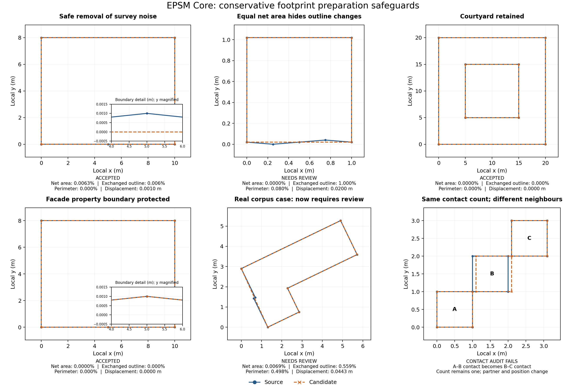

# Footprint preparation and perimeter zoning

New GeometrySpec inputs enable `FootprintCleanupSpec()` by default: topology-preserving simplification at 0.01 m with a maximum 0.001 relative net and exchanged-outline area change and 0.01 relative perimeter change (version 2). Source rings stay in `geometry.parts`; `geometry.footprints`, heated-area properties, geometry preview, quantities and compilation use the prepared rings. Invalid source polygons are rejected rather than repaired automatically.

```python
from epsm_core import FootprintCleanupSpec

# Reproduce source rings explicitly.
geometry = geometry.updated(footprint_cleanup=FootprintCleanupSpec(enabled=False))
# Stronger preparation must be requested explicitly.
geometry = geometry.updated(footprint_cleanup=FootprintCleanupSpec(
    tolerance_m=0.1, max_area_change_fraction=0.01))
```

The pass removes duplicates and collinear vertices, preserves hole counts and shared part contacts, and checks bidirectional boundary displacement and area change. Changes to explicitly referenced façade IDs are rejected; disable cleanup or supply separately prepared geometry and reviewed references. No area scaling to external observations occurs.

Compilation reports include cleanup version, settings, source hash, original/prepared vertex counts, areas, perimeters, displacement, exchanged-outline area and edge lineage. The settings and implementation version are included in the physical specification hash. Default-enabled cleanup changes hashes even when the outline remains geometrically identical. Existing saved specifications acquire this default when loaded; choose disabled mode to retain their original rings. Keep the old compiler version to reproduce historical generated geometry exactly.

Perimeter/core zoning remains optional; per-storey remains the default. Perimeter geometry is placed on one 1e-8 m scene grid before subdivision. Generated intersections within 0.010001 m of source corners are aligned coherently across all partitions. This may make a tiny local change in thermal partition depth; coverage and overlap checks enforce the physical floor outline. The grid and alignment bound are recorded in the zoning report. Redundant generated surface vertices are removed before serialization, preserving normals and shared boundaries. Boundary identities and clipped-window containment use a 1e-7 m numerical tolerance; real gaps, overlaps, nonplanarity and short edges still fail validation.

Basements remain whole-floor zones and attics retain their roof-based subdivision. Their contacts with partitioned residential floors use reciprocal shared surface geometry. Kiva exposed perimeter is computed from the physical exterior, excluding internal zone boundaries.

## Preparation safeguards (version 2)

`prepare_geometry` now defaults to `GeometryPolicy(version="conservative-metric-2")`.
It retains the original geometry, candidate, acceptance status and source-edge lineage.
The new `max_symmetric_difference_fraction=0.005` limit measures **removed plus added
plan area divided by source area**. This closes a gap in net-area checks: an inward
and an outward notch can cancel in total area while changing the outline. Invalid
source polygons do not receive a reliable symmetric-difference metric; validity
repair always requires review. A version label on `GeometryPolicy` is provenance,
not a selector for an older algorithm.

Component contacts are matched by maximum plan overlap with a unique correspondence,
so canonical component reordering does not trigger a false failure. The audit checks
contact partners, intersection type and continuous contact geometry, allowing only
`precision_m * sqrt(2)` movement for coordinate rounding. A contact switching from
A–B to B–C requires review even when the number of contacts stays the same. This is a
conservative correspondence check; ambiguous component matching requires review.

New automatic cleanup inputs default to `implementation_version="footprint-cleanup-2"`.
They retain 0.01 m simplification and 0.001 net-area limits, and additionally enforce:

- `max_symmetric_difference_fraction=0.001` for exchanged outline area;
- `max_perimeter_change_fraction=0.01`, including courtyard boundaries;
- densified Hausdorff distance and continuous boundary containment in both directions.

Explicitly saved `footprint-cleanup-1` inputs retain their original simplification and
area/displacement acceptance checks. Both versions report exchanged outline area,
perimeter change and source-edge lineage. The report records the requested version;
settings and version affect the physical specification hash. Loading inputs with no
version selects the new default. New fields also change serialized specifications,
including explicitly selected legacy inputs; retain historical software for exact
historical hash/report reproduction.

The shared compile/preview pipeline previously protected window overrides; the patch
extends that guard to balcony references. Party-wall references already have a guard.
A changed ring can renumber edges even if its area and boundary are geometrically
identical. Cleanup therefore rejects **any changed part with these references**.
It does not apply old properties by a coincident edge index or automatically infer
property inheritance from lineage. Disable cleanup for that geometry, or supply
separately prepared rings and explicitly reviewed references. Unreferenced parts can
still be simplified. GIS `edge_properties` conservatively protects entire containing
rings from simplification; precision rounding and canonical reordering still occur,
so use the returned lineage when assigning properties.

### Illustrations and regression evidence



Run `PYTHONPATH=src python examples/preparation_safeguards.py` with the notebook extra
installed to regenerate [the SVG](figures/preparation/safeguards.svg), PNG and
[numerical evidence](figures/preparation/evidence.json). The plots demonstrate safe
survey-noise removal, cancelling area changes, courtyard retention, protected facade
boundaries, one real corpus case and a synthetic contact-partner switch. The contact
comparison demonstrates the audit directly; it is not a simplifier-generated result.

Of the 300 archived raw-footprint corpus cases, version 2 changes one previously
accepted status to `needs_review`: municipality 2584, building
`9a0fd2bb-0631-4b95-97ca-7e92fe8d44ce`. Its source area is 12.4566 m², net area change
0.00686%, exchanged outline 0.55916%, perimeter change 0.49752%, and maximum displacement
0.04432 m. The candidate shape is unchanged; the acceptance decision is stricter.
Historical fixture evidence remains intact, with the new expected review explicitly
recorded in the corpus regression test.

These checks establish bounded **geometric** change. They do not establish annual
energy equivalence or solar/shading equivalence. There is no height-dependent
simplification budget, automatic low/high-rise policy, calibrated energy sensitivity
threshold, or automatic facade-property transfer. Engine surface constraints remain
independent checks: a geometrically accepted footprint can still produce a short
edge or small shading face that fails downstream validation. Thresholds should be
validated against paired energy runs before increasing them for Swedish stock.
