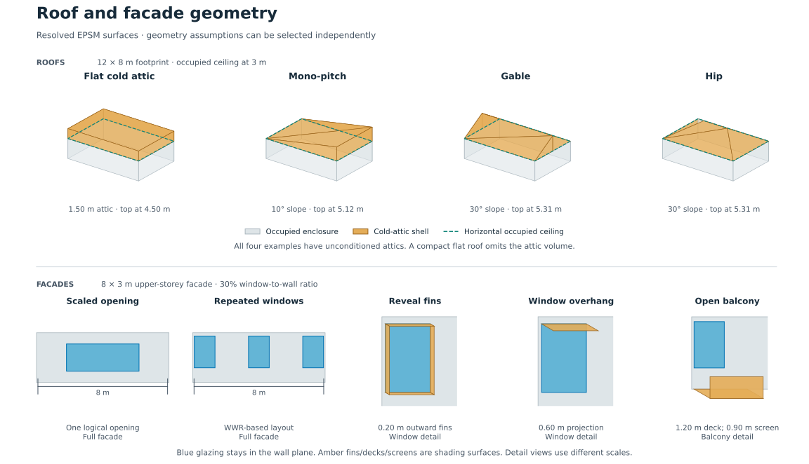
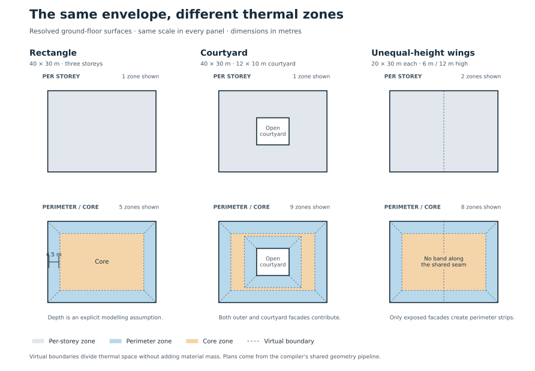
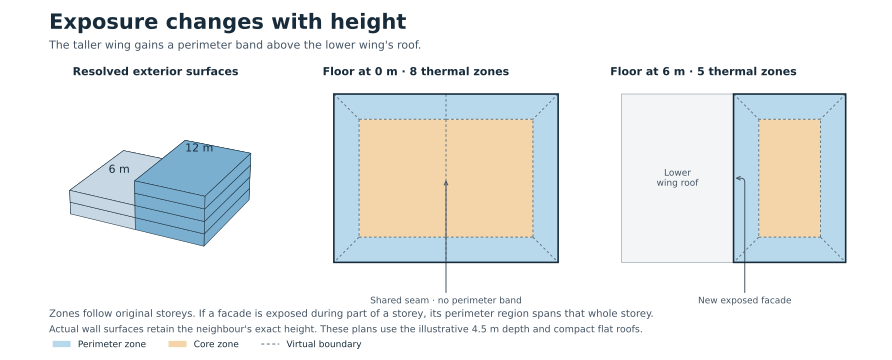
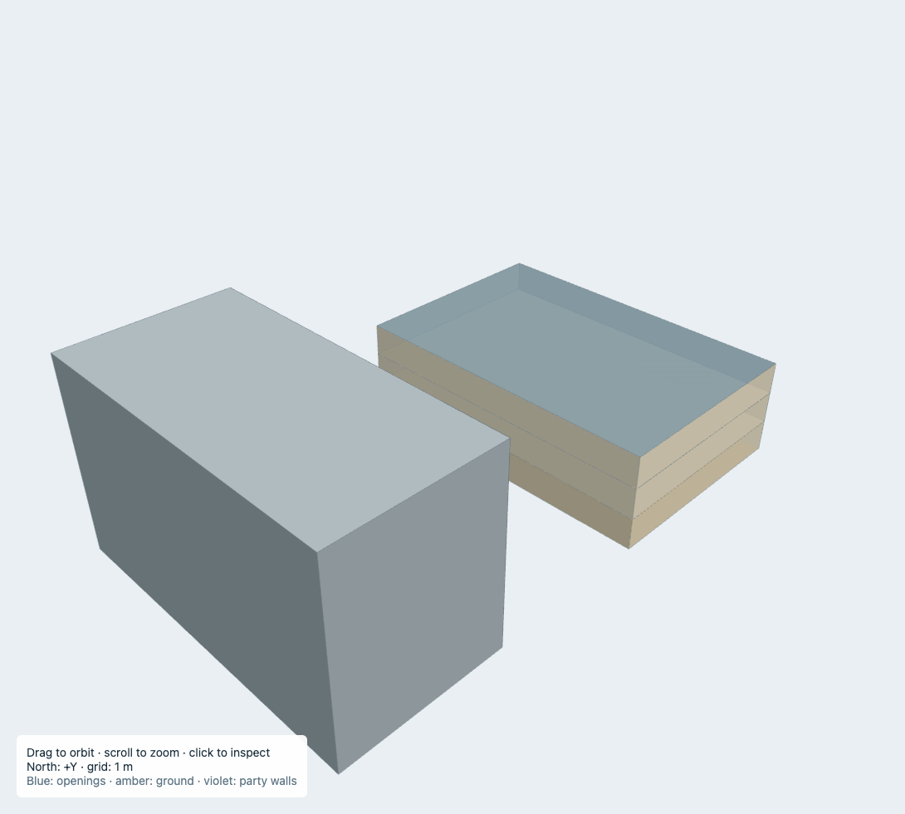
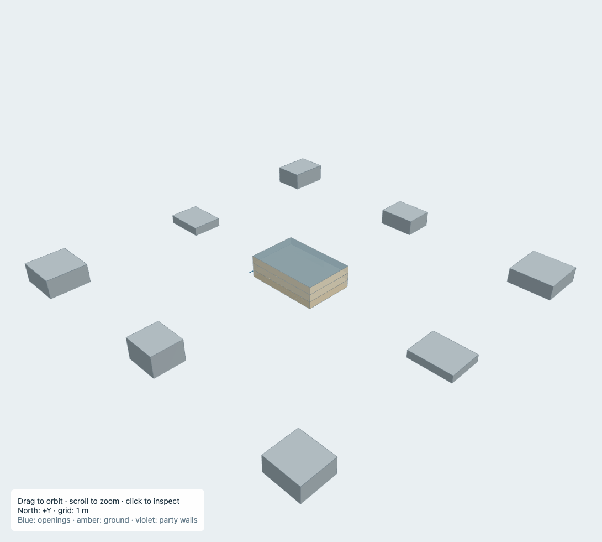
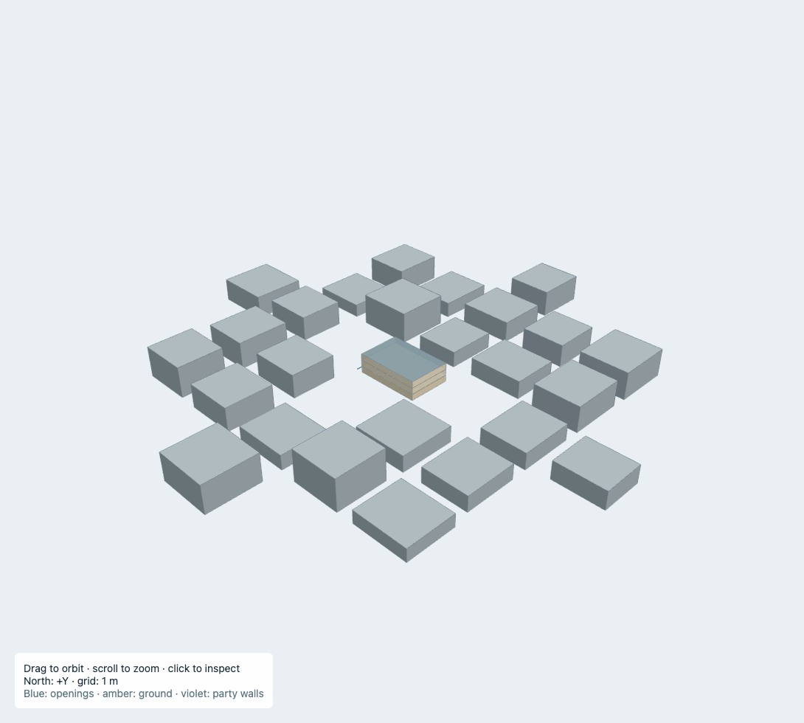
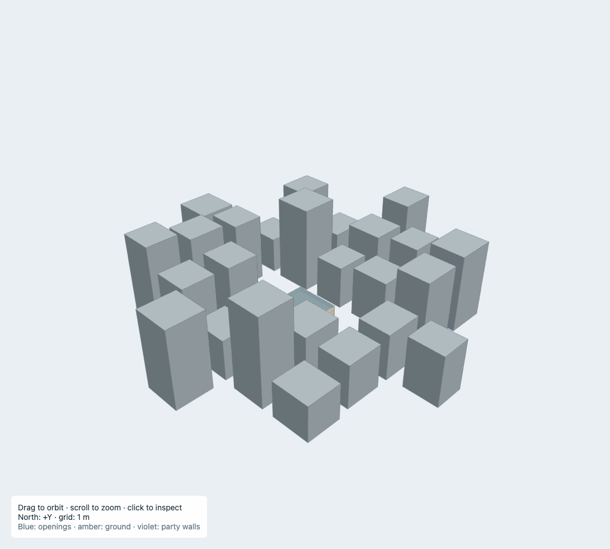
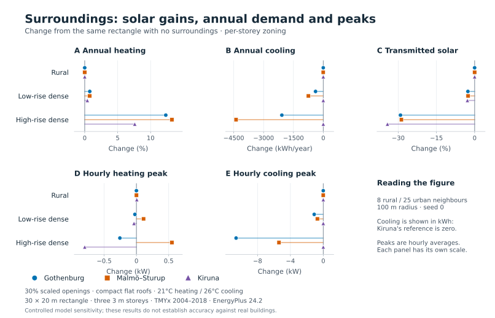
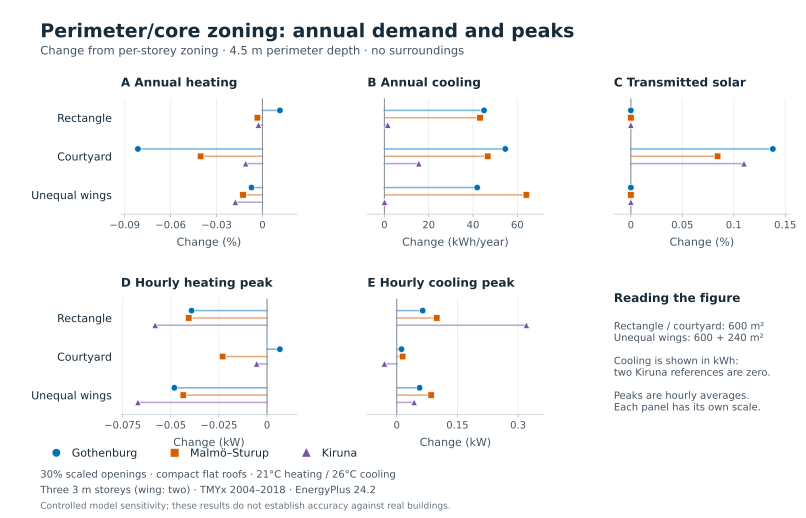

# Geometry feature contract

EPSM creates procedural energy-model geometry from metric footprints, known heights and explicit assumptions. It targets national UBEM workflows; it does not reconstruct detailed interior plans.

| Capability | Status and limits |
| --- | --- |
| Footprints | Valid concave polygons, courtyard holes and disconnected components |
| Massing | Nonoverlapping plan-area parts with unequal heights; all parts begin at uniform grade |
| Storeys | Explicit elevations, or a storey count and height; physical intermediate slabs |
| Basement | Full-footprint basement, conditioned or unconditioned; explicit boundary constructions |
| Windows | Scaled openings; repeated openings from WWR or dimensions; facade/storey overrides |
| Attached shading | Reveal fins, window or continuous overhangs, open balconies and screens |
| Roof | Flat, mono-pitch, gable and hip; pitched roofs use cold attics |
| Whole-building zoning | One zone per connected compatible volume |
| Per-storey zoning | Default; separate part/storey zones |
| Perimeter/core zoning | Exposed-facade strips plus remaining cores; explicit configurable depth |
| Apartment zoning | Experimental bounded residential generator; explicit error/fallback policy |
| Custom context | Neighbour footprints, heights and base elevations; shading only |
| Synthetic context | Rural, low-rise dense and high-rise dense illustrative scenarios |
| Inspection | Facade catalog and geometry-only preview, independent of EnergyPlus |

Supplied floorplans, individually positioned windows, BIM import, terrain steps, arbitrary overlapping solids, partial foundations, occupied pitched rooms, intersecting roof unions, dormers, enclosed balconies and vegetation are outside this release. Touching parts with pitched roofs remain unsupported; combine compatible footprints upstream or use separated parts.

## Footprints and facade identity

Input coordinates must already be metric. `source_crs` records their source; it does not reproject them. Preparation is explicit through `prepare_geometry`; construction does not silently repair or replace the outline. Holes and disconnected components are preserved.

`geometry.facades()` returns original facade IDs, endpoints, lengths, outward azimuths and storeys. IDs follow canonical part/ring/edge identities. Use those IDs in `FacadeOverride` and `BalconySpec`; unknown IDs or storeys are rejected. The catalog describes original part boundaries; shared/party surfaces receive no external windows.

`orientation_deg` rotates the complete scene clockwise, including context. Geographic district inputs already carry their orientation and therefore use zero additional rotation.

## Windows and attached shading

`WindowLayoutSpec(mode="scaled")` places one area-scaled opening per contiguous rectangular exposure run. If scaling would make either opening edge shorter than the safe EnergyPlus limit, Core leaves that run opaque and records the reason alongside its requested and applied WWR. `mode="wwr"` solves repeated openings at the requested WWR. `mode="dimensions"` accepts window width, height and centre spacing; achieved WWR becomes an output. Infeasible requests in those explicit layout modes raise an error.

Facade defaults apply first, then facade-wide overrides, then storey-specific overrides. Overrides support WWR, layout, glazing properties, reveal depth and overhangs. Advanced low/mid/high pattern controls are modelling assumptions, not descriptions inferred from building age or location.

Logical window placement is independent of thermal zoning. A window crossing a thermal boundary is represented by multiple EnergyPlus panes; reports distinguish logical window and pane counts. Reveals and overhangs follow the logical opening, avoiding new shade edges at thermal cuts.

`reveal_depth_m` represents recess shading using outward fins around coplanar glazing. It does not model frame conduction or change the supplied window U-value. Balconies are opaque open shading surfaces; their junction thermal bridges and enclosed volumes are not modelled. Keep `solar_shading_factor=1` unless it represents an additional effect beyond explicit geometry.

*Rendered from current resolved geometry. Pitched roof shells sit above horizontal occupied ceilings. The detail views show the actual shading representation, including coplanar glazing and outward reveal fins; they do not imply recessed thermal window planes.*

## Roofs and thermal zoning

`RoofSpec` owns shape, pitch, direction, topology and flat-attic height. Flat roofs default to `topology="compact"`; use `topology="cold_attic"` for an unconditioned buffer. Pitched shapes resolve to cold-attic topology. Default pitches are 10° mono-pitch and 30° gable/hip. `attic_height_m` controls flat attics; pitched heights follow the footprint and slope. The occupied ceiling remains horizontal. Envelope constructions separately describe the top-floor boundary and exterior weather shell. Attics have no inferred ventilation.

Perimeter/core zoning defaults to a **4.5 m depth**. This is an illustrative choice, not a calibrated universal value. Perimeter strips follow exposed outer and courtyard facades. Shared ownership seams and reviewed party walls do not seed strips. Overlaps are allocated by inward perpendicular facade distance; remaining connected regions form cores. Narrow floorplates can have no core.

Height bands establish exposure; zones remain aligned to actual storeys. A facade exposed for part of a storey creates a full-storey perimeter region, while thermal surfaces preserve the actual neighbour height. Virtual zoning boundaries add no material mass. Area, volume, slabs and total prescribed loads are preserved. Unconditioned attics and basements retain their own zoning.

*Plans use the actual emitted floor surfaces at grade, with 4.5 m perimeter depth. Courtyard walls seed perimeter strips; the shared wing seam does not. Colours distinguish thermal regions, not different constructions.*

*The lower wing ends at 6 m. Above its roof, the taller part's newly exposed facade participates in perimeter zoning. Storey elevations and physical slabs stay unchanged.*

Workload guards allow up to 512 exposed facade segments, 20,000 overlapping strip pairs and 4,096 thermal cells. Reflex mitres longer than five times the requested depth fail explicitly.

Procedural zoning fails explicitly by default. `ZoningSpec(mode="perimeter_core", on_failure="per_storey")` permits substitution for a whole building. Compilation and result diagnostics record requested/effective modes and the reason. Exclude substituted results when comparing the requested detail. The same policy applies to experimental apartment generation.

Apartment generation requires explicit residential use and dwelling/common partition constructions. It can add circulation, stair voids and common-space operations; it is a different modelling package from virtual perimeter subdivision. Type mix targets are soft, while footprint coverage and valid physical boundaries remain mandatory.

## Surrounding buildings

`ContextSpec` stores resolved neighbours; procedural helpers generate those objects before compilation. Custom neighbours can occupy courtyard holes, but positive-area overlapping footprints are rejected. Boundary contact is allowed and does not itself establish a thermal party wall.

| Synthetic preset | Grid spacing | Footprint dimensions | Height range | Target clearance |
| --- | ---: | ---: | ---: | ---: |
| `rural` | 64 m | 10–18 m | 3–9 m | 20 m |
| `urban_lowrise_dense` | 32 m | 20–26 m | 6–15 m | 10 m |
| `urban_highrise_dense` | 32 m | 20–26 m | 24–60 m | 10 m |

The default radius remains 100 m pending multi-radius convergence validation; it is
the maximum minimum distance between target and neighbour footprints, not a centroid
distance. Seed is zero and the generated-building cap is 128. The versioned generator
uses signed grid coordinates and near-to-far acceptance: increasing radius preserves
every existing nearby building and identifier. The two urban presets have identical
horizontal geometry for the same seed/settings. Synthetic context avoids courtyard
voids; explicit context is preserved. Limits raise rather than silently truncate.

Context extrusions include walls, roofs and bottom caps. Read-only closure, outward
orientation and manifold checks qualify opaque static shells for global mirror
suppression. Any standalone façade shade keeps automatic mirroring enabled. Proven
invisible faces may be omitted from simulation; the full physical context remains
available to the viewer. The proof checks every receiver vertex against the outward
face plane and is conservative for every ray direction, including low solar angles.

Physical geometry uses exterior footprint dimensions and interior partition centerlines.
Generators own winding and convex horizontal decomposition. Shared coordinates are
interned on the existing 1e-8 m source-plane grid once; scene rotation preserves those
identities. Serializers only rotate vertex sequences cyclically. Validation never repairs
geometry. Roof heat-transfer surfaces cover the zone-contact area; façade overhangs
are separate shading geometry.

The minimum generated face edge is 0.010001 m. Short chamfered-shade probes against
the pinned EnergyPlus 24.2 binary confirmed vertex dropping below 0.01 m; the
application adds a 1 µm margin. Degenerate and redundant collinear face vertices
are rejected. This tolerance is independent of source-coordinate quantization.

| Custom neighbour | Rural |
| --- | --- |
|  |  |
| Explicit footprint and 18 m height | Seed 0: 8 neighbours, 3–9 m |

| Urban low-rise dense | Urban high-rise dense |
| --- | --- |
|  |  |
| Seed 0: 25 neighbours, 6–15 m | Same footprints; heights 24–60 m |

*Screenshots from the current context example, with a 30 × 20 m target and three 3 m storeys. Each view fits its own scene, so image scale varies. The urban presets share footprints, ordering and orientation. Context roof caps remain at their actual elevations, including when target cutaway is enabled.*

These presets are controlled geometric scenarios. They do not change weather, wind exposure or EnergyPlus terrain settings. `DistrictPlan` uses actual neighbour roof maxima for conservative flat extrusions and discloses that approximation.

## What changed the results in the comparison cases?

The following plots summarize 27 accepted annual EnergyPlus cases across Gothenburg–Landvetter, Malmö–Sturup and Kiruna. These are controlled sensitivity examples, not evidence of accuracy for an individual building or a national stock. They use demonstration constructions, 30% scaled WWR, compact flat roofs, 21°C heating and 26°C cooling setpoints. The [retained plot data](figures/geometry-sensitivity-data.json) records the exact run IDs, source revision and weather identifiers.

*Relative to the same rectangle with no neighbours, high-rise context increased annual heating by 7.6–13.2% and reduced transmitted solar by 28.8–34.2%. Cooling fell by 70.3–85.0% in Gothenburg and Malmö–Sturup; the Kiruna rectangle had zero baseline cooling. Context therefore mattered for solar access and cooling as well as heating in these cases.*

*Across nine matched zoning comparisons, annual heating changed by less than 0.1%; hourly heating peaks changed by less than 0.07 kW. Cooling differences are plotted in kWh to keep near-zero Kiruna baselines interpretable. Peaks are hourly averages, not subhourly design loads. These results support per-storey zoning as an economical baseline for these cases; they do not establish that finer zoning is unnecessary for other envelopes, schedules or local comfort questions.*

Roof shape, recess depth, repeated windows and balcony detail were not varied in this 27-case comparison. The geometry illustrations above describe their implementation; they do not assign an energy benefit to each feature. Compare those features with matched physical inputs before choosing their level of detail for a workflow.

### Opaque context emission and terrain datum

Compilation preserves the complete measured neighbour shells for inspection and
mirror proofs. For static opaque, nonreflecting context, only faces at or above
the lowest outdoor solar receiver need be emitted: a sun-up ray from any receiver
cannot intersect geometry below that plane. The compiler clips such faces, retains
all original vertices above the plane, and records clipping and omissions under
`context.emission`. Exact opposing coincident faces at touching opaque prisms are
internal interfaces; duplicate aliases retain one face. Genuine outdoor receivers
below grade are preserved and are not silently moved to grade.

The 16-vertex engine workspace hint lies inside a ground footprint. For a basement
with all outdoor receivers above grade it is placed at grade, below the receivers,
instead of on the negative basement floor. This changes neither the physical
basement nor its ground heat transfer. EnergyPlus 24.2
[CalcSurfaceCentroid](https://github.com/NREL/EnergyPlus/blob/v24.2.0/src/EnergyPlus/SurfaceGeometry.cc)
warns about negative shading centroids; the strict warning policy remains intact.
See also the [shading Engineering Reference](https://bigladdersoftware.com/epx/docs/24-2/engineering-reference/shading-module.html).

### Exact context cap coalescing and convex attic walls

The 5 October 2026 national 200-building rerun exposed 13 geometry/shadow
rejections after roof preparation and weather recovery had allowed more buildings
to reach EnergyPlus. Twelve of these buildings had previously failed preparation;
one already had a small-context-face rejection. These are separate from the earlier
zero-clearance roof, below-datum shading and coincident-context repairs. Those
repairs were present in the frozen rerun; they did not guarantee that every
subsequently generated face would satisfy every engine diagnostic.

Ten cases contained small triangles on neighbouring **roof or bottom caps**, not
thermal envelope surfaces. Constrained Delaunay triangulation can create a small
ear from three almost-collinear outline vertices despite acceptable edge lengths.
EnergyPlus 24.2 `GetSurfaceData` warns for areas from 1e-6 up to, but excluding,
0.001 m². Removing such patches would change solar access and is not a general
repair. Core instead coalesces adjacent horizontal patches when their **exact
union** is convex, has at most four vertices, and passes surface validation. The
full shared-edge index bounds candidate searches; deterministic passes terminate
because each successful merge removes one patch. Coalescing also reduces ordinary
cap fragmentation without modifying the shadow-clipping method or workspace limit.

The merge retains boundary coordinates and winding and cannot fill courtyard
holes. It also checks the engine's 1e-6-radian turning-angle threshold, preventing
new quads that EnergyPlus would repair by dropping a nearly collinear vertex.
Coverage, non-overlap and area conservation are checked to the same relative
1e-9 area tolerance as horizontal decomposition. Both the top and bottom use the
same decomposition. The viewer directly fan-triangulates convex faces from the original world
vertices, preserving exact shared coordinates. This avoids projection round-trip
perturbations that caused a false courtyard-cap coverage gap in preview checks;
polygons with openings still use constrained triangulation. Complete context shells still undergo closure and mirror
eligibility checks before visibility pruning and solar-receiver clipping.
`context.cap_tessellation` records the method `exact_convex_cap_coalescing_v1`,
original/resolved patch counts, count reductions, remaining patches below 0.001 m²,
and symmetric-difference area for each neighbour footprint. The patch counts refer
to one complete cap before visibility and emission clipping.

The enclosure case was `main_attic_2` of anonymised building
`a5318d1c-ca1f-460b-98f7-9dcafe654629`. A gable ridge crossed one facade about
33 mm from its endpoint, producing two wall segments and a floor-edge T junction.
Core's precise edge noding verified the complete shell, but EnergyPlus's enclosure
test uses 1 cm point/line tolerances when inserting missing collinear points and
reported the short edge of `MAIN_ATTIC_WALL_37` as unmatched. This is a compatibility
issue in tessellation, separate from the earlier zero-clearance roof-facet defect.

For a facade with exactly one interior roof node, Core now emits the complete
wall as one convex triangle, quad or pentagon when it passes the surface and
engine-turn checks. This removes the artificial floor-edge split while preserving
ridge nodes, footprint, thermal surface area, volume, facade identity and
construction. Concave, redundant or otherwise unqualified profiles retain segment
emission. Directed-edge closure and volume checks remain mandatory for every zone;
no enclosure warning is waived.

Pinned source reference: EnergyPlus 24.2
[SurfaceGeometry.cc](https://github.com/NREL/EnergyPlus/blob/v24.2.0/src/EnergyPlus/SurfaceGeometry.cc),
functions `GetSurfaceData`, `CheckConvexity`, `isEnclosedVolume`, and
`isPointOnLineBetweenPoints`.

Fresh annual Core runner checks of all 13 retained cases recovered **six**:
five small-context-face cases and the attic enclosure case. All six passed engine
diagnostics and full output validation; annual space-heating demand changed by
at most **0.000136%** against the retained outputs. The remaining **five** small-face
cases and **two** shadow-overlap-capacity cases still reject. Some residual small
features cannot be merged without changing the measured boundary or introducing
engine-collinear vertices. They need a separately assessed preparation or
retessellation change. The overlap cases still exceed the one-million-figure
workspace after cap coalescing; increasing capacity, removing neighbours or
changing the shading method is not qualified by this repair.

Small-area warnings now classify as `invalid_geometry`, producing
`GEOMETRY_INVARIANT_FAILURE` rather than a generic warning-policy rejection.
The strict acceptance rules for remaining geometry and shadow warnings are retained.
Existing frozen study receipts and metrics are unchanged. A new campaign is required
to apply these source changes. Local replay scripts, original-case comparisons,
engine artifacts and `fixed-v3-results.json` are retained in the workflow repository
under `output/national-mf-se02-random-baseline-2026-10-05-v2-roof-weather/geometry-review`.
