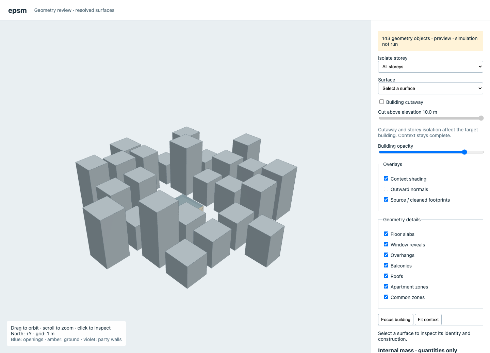

# Usage

Install Python 3.11+ and the package. The optional geometry extra supplies the straight-skeleton backend used by hip roofs and experimental apartments.

```sh
python -m pip install -e '.[dev,geometry]'
```

Put local EPWs in `data/weather/`. EPSM does not download weather or discover material assumptions. Select `BuildingBuilder(building_use="residential")` to load the bundled, version-pinned Sveby residential normal-use specification. `BuildingBuilder()` supplies no operational profile. For simulation, supply an EnergyPlus 24.2 executable and its adjacent `Energy+.schema.epJSON`.

## Default residential operations

`BuildingBuilder(building_use="residential")` selects Sveby *Brukarindata bostader* 2.0. The stored profile supplies residential setpoints, occupancy, internal gains, annual DHW, common-space temperature, the fallback solar-shading factor and minimum mechanical outdoor air. Physical inputs—including weather, envelope constructions, ventilation topology, leakage and heat-recovery performance—remain explicit.

```python
from epsm_data import select_operating_profile
from epsm_core import BuildingBuilder

definition = select_operating_profile("multi_family", version="2.0")
print(definition.profile_id)
builder = BuildingBuilder(building_use="residential")  # selects that profile
```

Sveby specifies occupancy by apartment size rather than one universal density. Until apartment counts and Atemp are supplied, the selected residential profile uses the separately labelled EPSM density fallback. Inspect `definition.values["model_completion_defaults"]` to identify such model-completion assumptions. Monthly DHW/electricity profiles, kitchen boost flow and the post-simulation window-airing correction are retained in the stored source profile but are not silently approximated by the current compiler.

## Start with geometry


*Geometry inspection comes before weather, constructions and operations are needed. [Editable flowchart](figures/workflow.mmd).*

```sh
python examples/geometry.py --shape rectangle --zoning per_storey --headless
python examples/geometry.py --shape courtyard --zoning perimeter_core --headless
python examples/geometry.py --shape wings --zoning perimeter_core --headless
python examples/context.py --preset custom
python examples/context.py --preset rural
python examples/context.py --preset urban_lowrise_dense
python examples/context.py --preset urban_highrise_dense
```

These commands save inspection artifacts beneath `output/`. Omit `--headless` on the geometry example to keep its browser preview open. Context examples save JSON neighbours and a viewer without starting a lasting server.

To open a saved context viewer, serve its generated assets locally, then visit `http://127.0.0.1:8000/`. Opening `index.html` directly as a file prevents the browser from fetching the model.

```sh
python -m http.server 8000 --bind 127.0.0.1 --directory output/context/viewer
```



*Actual geometry-only preview: a 30 × 20 m, three-storey target with 25 synthetic high-rise neighbours. The target is beige; context is grey. No simulation has been run for this screenshot.*

The viewer initially fits the complete context. Use **Focus building** to inspect the target and **Fit context** to return to the surroundings. **Building cutaway** starts off; enable it to remove target surfaces above the chosen elevation. Cutaway, building opacity, roof visibility and storey isolation leave context buildings complete. Neighbour surfaces stay opaque so their roof caps are unambiguous. Click a surface to inspect its vertices, identity and available metadata; geometry-only previews have no assigned material layers.

If a previously saved viewer shows open-topped neighbours, regenerate it with the current package and reload the page. Earlier viewer assets applied the target-height clipping plane to neighbours as well, hiding their existing roof caps. This was a display issue; it did not remove simulation shading surfaces. Deliberate cutaways do not create artificial closing faces.

## Describe a building and simulate

The building example supplies explicitly labelled demonstration constructions and operations. Replace them with known properties or a caller-owned assumption profile for production use.

```sh
python examples/building.py data/weather/SWE_VG_Gothenburg-Landvetter.AP.025260_TMYx.2004-2018.epw output/building.json
epsm-core validate output/building.json
epsm-core schema > output/building-schema.json
epsm-core --energyplus /path/to/energyplus compile output/building.json output/model
epsm-core view output/model/model.epJSON --headless
epsm-core --energyplus /path/to/energyplus run output/building.json output/run
```

Compile/run destinations must be empty. Use a new destination for another run. Validate checks the input contract; compile additionally checks the generated physical surfaces and EnergyPlus schema; run performs engine and result validation.

The Python workflow is: construct known footprint/storeys, inspect facade IDs, specify aggregate window/glazing/shading assumptions, choose roof and zoning, add context, preview, then attach constructions/weather/operations in `BuildingSpec` and simulate. See [API examples](api.md) and [feature limits](geometry.md).

## Batch use

Use per-storey zoning as the economical baseline. Select perimeter/core explicitly for facade-oriented subdivision. If uninterrupted case processing is required, request `on_failure="per_storey"` and retain the substitution diagnostics. A fallback result is not evidence for the failed geometry method.

Synthetic contexts are generated once before compilation, then can be saved, inspected and reused. Real neighbours should come from caller-supplied footprints/heights. `DistrictPlan` resolves neighbours for independent target simulations in a shared metric coordinate frame; it does not couple their HVAC or indoor temperatures.

Study orchestration, persistence, national data ingestion and statistical analysis belong in `epsm_workflows`. Keep their outputs outside the active package source tree.

## Development checks

```sh
python -m pytest tests/core
ruff check src tests examples
```

EnergyPlus integration tests use `ENERGYPLUS_EXE` or the documented local fixture location and the Gothenburg EPW in `data/weather/`. They skip when the executable is unavailable. The geometry corpus is self-contained under `tests/fixtures/footprints/`. Viewer server tests require permission to bind a loopback port.

## Rebuild documentation figures

Figures are committed under `docs/figures/` so a checkout displays them immediately. Geometry figures use current resolved surfaces; sensitivity plots use the small adjacent [retained dataset](figures/geometry-sensitivity-data.json), including run IDs, source hash, climate identifiers and assumptions. They do not read historical result directories. SVG flowcharts display without a Mermaid extension.

```sh
python -m pip install matplotlib
python docs/figures/geometry_partitions.py
python docs/figures/plot_roof_facade.py
python docs/figures/plot_geometry_sensitivity.py
```

To regenerate screenshots and verify the context viewer controls, install Puppeteer under ignored `output/`. The capture script generates fresh geometry scenes from the maintained context example, checks all four presets, and writes browser-check results beneath `output/validation/`.

```sh
npm install --prefix output/docs-tools puppeteer
node docs/figures/capture_viewers.mjs
```

`EPSM_PYTHON`, `EPSM_PUPPETEER_MODULE` and `EPSM_BROWSER_EXECUTABLE` optionally select an existing Python, Puppeteer module or Chromium executable. Screenshot capture requires a loopback listener and a browser process. It does not require EnergyPlus.

To edit and render the flowcharts:

```sh
npm install --prefix output/docs-tools @mermaid-js/mermaid-cli
output/docs-tools/node_modules/.bin/mmdc -i docs/figures/workflow.mmd -o docs/figures/workflow.svg -t neutral -b transparent
output/docs-tools/node_modules/.bin/mmdc -i docs/figures/geometry-pipeline.mmd -o docs/figures/geometry-pipeline.svg -t neutral -b transparent
```
